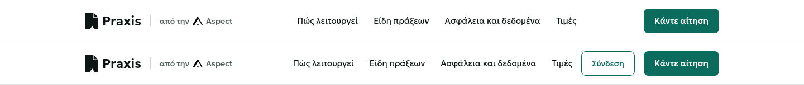
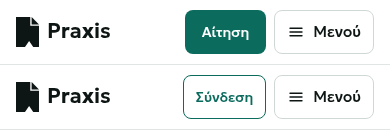

# Βήμα 1 — Κουμπί «Σύνδεση»

Βάση: το τρέχον `main`, `5c522184d339885cf1ac0e20703d9ef8326a000c`. Branch: `feat/login-link`. Έλεγχοι: 16 Νοεμβρίου 2026, Node 24.22.1, Chromium 155.0.8059.79, τοπικό στατικό build με τα υπάρχοντα security headers.

## Αλλαγή

Η κοινή κεφαλίδα χρησιμοποιεί το `APP_URL = 'https://app.aspect-praxis.com'` από το `src/config/site.ts`. Η «Σύνδεση» είναι κανονικός σύνδεσμος με το υπάρχον δευτερεύον Button, ορατός χωρίς άνοιγμα μενού σε όλες τις σελίδες, συμπεριλαμβανομένης της Αίτησης. Το HTML `href` είναι ακριβώς το `APP_URL`. Κατά την πλοήγηση ο browser κανονικοποιεί το URL σε `https://app.aspect-praxis.com/`.

Στο κινητό (<1000 px), η «Αίτηση» παραμένει στο υπάρχον μενού. Το λογότυπο, η «Σύνδεση» και το κουμπί μενού έχουν ύψος 44 px και πλάτος τουλάχιστον 44 px. Η σύνδεση λειτουργεί και χωρίς JavaScript. Δεν προστέθηκε JavaScript στο προϊόν.

## Ακριβής λίστα οπτικών διαφορών

1. **1440 px, όλες οι σελίδες:** προστίθεται η δευτερεύουσα «Σύνδεση» πριν από την κύρια «Κάντε αίτηση», στη θέση x=1041,375, με μέγεθος 95,375 × 44 px. Οι σύνδεσμοι πλοήγησης μετακινούνται 7,328125 px αριστερά (πρώτος σύνδεσμος x=532 → 524,671875). Λογότυπο, απόδοση στην Aspect, κύρια αίτηση και ύψος κεφαλίδας παραμένουν στις ίδιες θέσεις. Στην Αίτηση διατηρείται η υπάρχουσα κρυφή/ανενεργή θέση της κύριας αίτησης.
2. **390 px:** η δευτερεύουσα «Σύνδεση» παίρνει τη θέση της ορατής κύριας «Αίτηση», με μέγεθος 83,375 × 44 px και x=182,8125. Στην ίδια τη σελίδα Αίτησης εμφανίζεται στον προηγουμένως κενό χώρο. Λογότυπο και μενού παραμένουν στις ίδιες θέσεις. Η κύρια αίτηση παραμένει μέσα στο μενού.
3. **360 px:** ίδια συμπεριφορά, με τη «Σύνδεση» στο x=152,8125 και το μενού στο x=244,1875. Δεν υπάρχει σύγκριση Βήματος 6 σε αυτό το πλάτος· έγινε ξεχωριστή σύγκριση με νέα λήψη του αρχικού `main` στο ίδιο περιβάλλον.
4. **Ενδιάμεσα πλάτη:** η διάταξη της κεφαλίδας προσαρμόζεται για το επιπλέον κουμπί. Κάτω από 1000 px η αίτηση βρίσκεται μόνο στο μενού. Δεν αλλάζουν τα περιεχόμενα, οι διαστάσεις ή η λειτουργία του αναπτυγμένου μενού.

Καμία άλλη νέα οπτική διαφορά: 12 συγκρίσεις των έξι σελίδων στα 390/1440 px με το αμετάβλητο Βήμα 6 (`7efa4f5:artifacts/step-6`) έχουν **0 διαφορετικά pixels κάτω από την κεφαλίδα**. Τα πλήρη μεγέθη των εικόνων είναι ίδια. Επιπλέον, και οι 18 συγκρίσεις με νέες λήψεις του αρχικού `main` στα 360/390/1440 px έχουν 0 διαφορετικά pixels κάτω από την κεφαλίδα. Δεν έγινε ανανέωση ιστορικών εικόνων αναφοράς. Οι παλαιότερες αποκλίσεις του Βήματος 6 από το αρχικό σχέδιο δεν αποτελούν νέες αλλαγές.

Πριν πάνω / μετά κάτω:

## Έλεγχοι

- `npm ci`, `npm run build`: επιτυχία, Astro static, επτά παραγόμενες σελίδες μαζί με την 404.
- Όλες οι υπάρχουσες σουίτες: `npm test`, `test:home`, `test:pages`, `test:data-pricing`, `test:application`, `test:audit`, `test:security`: επιτυχία.
- `npm run test:login`: 18 συνδυασμοί (έξι σελίδες × 360/390/1440), ακριβές href, ορατό δευτερεύον κουμπί, διαδοχή Tab, ορατή εστίαση, ενεργοποίηση με Enter και αφή/κλικ. Μηδενικές παραβάσεις axe WCAG A/AA με κλειστό και ανοιχτό μενού. Χωρίς οριζόντια κύλιση, cookies ή αποθήκευση browser.
- Επιπλέον 12 πλάτη: 360, 390, 600, 601, 768, 999, 1000, 1100, 1101, 1199, 1200, 1440 px. Χωρίς επικάλυψη στόχων ή υπερχείλιση, ορατή σύνδεση με απενεργοποιημένο JavaScript.
- Μενού: Enter/Space/Escape, αφή, επιστροφή εστίασης, κρυφοί σύνδεσμοι εκτός Tab, εσωτερική πλοήγηση και διαθέσιμη «Κάντε αίτηση». Εσωτερικοί σύνδεσμοι και άγκυρες: επιτυχία.
- Lighthouse: και οι έξι σελίδες σε υπολογιστή/κινητό, **Accessibility 100 / Best Practices 100**, 12 εκτελέσεις.
- Φόρμα: 46 προσομοιωμένες περιπτώσεις/έλεγχοι εγκυρότητας, μεταξύ άλλων 200/400/429. Security: 21 περιπτώσεις σελίδων/πλατών, αμετάβλητα headers/CSP/noindex, προσομοιωμένα αιτήματα και αποκλεισμός εγγενούς υποβολής.
- Όλες οι ενεργοποιήσεις της «Σύνδεση» και όλες οι υποβολές φόρμας αναχαιτίστηκαν τοπικά. **Καμία πρόσβαση σε πραγματικό λογαριασμό ή πραγματική αίτηση.**

Οι προσαρμογές υπαρχόντων tests περιορίζονται στις θέσεις/ορατότητα της εγκεκριμένης κεφαλίδας, στον νέο επιτρεπόμενο προορισμό και στην εξαίρεση της ακριβούς περιοχής κεφαλίδας από τη σύγκριση με το Βήμα 6. Η σύγκριση απαιτεί ίδια διάσταση εικόνας, αμετάβλητο ύψος κεφαλίδας και μηδενική διαφορά σε κάθε pixel του υπόλοιπου περιεχομένου. Οι έλεγχοι φόρμας, νομικών συνδέσμων, ασφαλείας και περιεχομένου διατηρούνται.

## Στιγμιότυπα όλων των σελίδων

| Σελίδα | 360 px | 390 px | 1440 px |
| --- | --- | --- | --- |
| Αρχική | [Εικόνα](index-360.png) | [Εικόνα](index-390.png) | [Εικόνα](index-1440.png) |
| Πώς λειτουργεί | [Εικόνα](pos-leitourgei-360.png) | [Εικόνα](pos-leitourgei-390.png) | [Εικόνα](pos-leitourgei-1440.png) |
| Είδη πράξεων | [Εικόνα](eidi-360.png) | [Εικόνα](eidi-390.png) | [Εικόνα](eidi-1440.png) |
| Ασφάλεια και δεδομένα | [Εικόνα](dedomena-360.png) | [Εικόνα](dedomena-390.png) | [Εικόνα](dedomena-1440.png) |
| Τιμές | [Εικόνα](times-360.png) | [Εικόνα](times-390.png) | [Εικόνα](times-1440.png) |
| Αίτηση | [Εικόνα](aitisi-360.png) | [Εικόνα](aitisi-390.png) | [Εικόνα](aitisi-1440.png) |

[Μενού 360](menu-360.png) · [Μενού 390](menu-390.png) · [Εστίαση 360](focus-360.png) · [Εστίαση 390](focus-390.png) · [Εστίαση 1440](focus-1440.png).

## Τεκμήρια και όρια

[Αποτελέσματα σύνδεσης και οπτικών συγκρίσεων Βήματος 6](results.json) · [Σύγκριση με αρχικό main](main-visual-comparison.json) · [Μετρήσεις κεφαλίδας](header-measurements.json) · [Ακεραιότητα πηγών και παραγόμενου JavaScript](source-integrity.json) · [Lighthouse](lighthouse-summary.json) · [Υπάρχοντες έλεγχοι](regression/) · [Ασφάλεια](security-results.json).

Το παραγόμενο HTML και των επτά σελίδων είναι ίδιο εκτός κεφαλίδας και ονομάτων αρχείων CSS. Τα παραγόμενα αρχεία JavaScript είναι ίδια byte προς byte. Αμετάβλητα `design/`, φόρμα/API, κείμενα, `[●]`, τιμές, υποσέλιδο, υπόλοιποι σύνδεσμοι εφαρμογής, τοπικά assets/γραμματοσειρές, dependencies, CSP, noindex και security headers. Ο φάκελος τεκμηρίων δεν περιλαμβάνεται στο στατικό build.

Η παράδοση αφορά μόνο commit/push στο `feat/login-link` και αίτημα ελέγχου προς `main`, χωρίς merge. Τα προστατευμένα refs επιβεβαιώνονται στα [πριν](protected-refs-before.txt) / [μετά](protected-refs-after.txt). Δεν έγινε αλλαγή στο `main`, στο `cf-placeholder`, στο Draft PR #8, στο Cloudflare ή στο DNS. Δεν εκτελέστηκε deployment.
